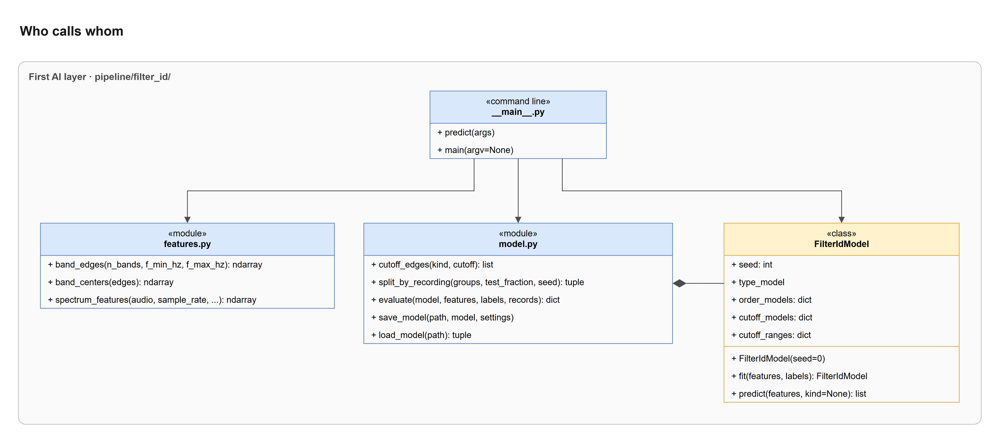
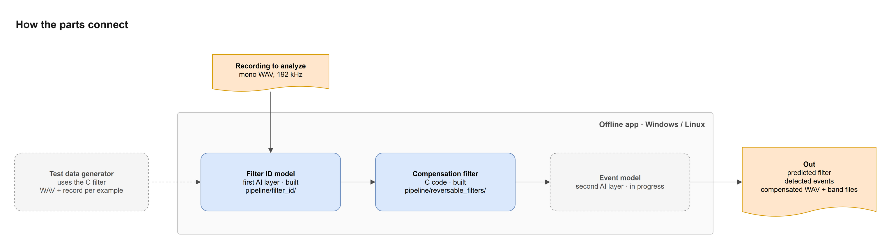
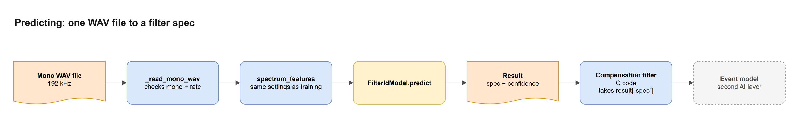
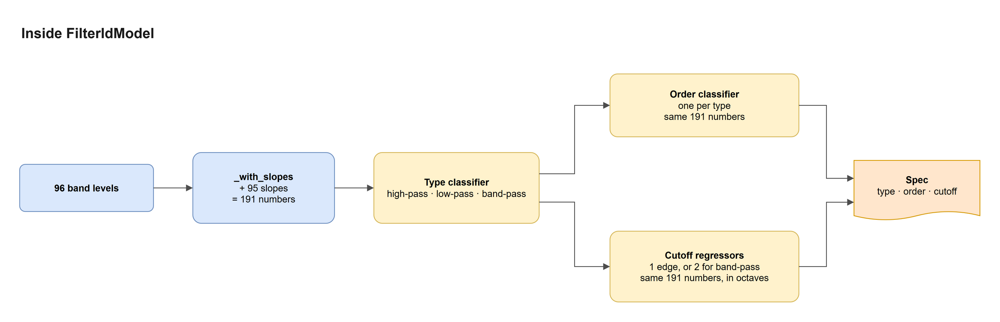

# Filter ID Code Map

Blue is built code, yellow is the `FilterIdModel` class, orange is a file or data, and a dashed box isn't built yet. A solid arrow is a call or hand-off, and a dashed arrow is something done ahead of time, like training.

## 1. Code structure

The diamond means `model.py` defines `FilterIdModel`, and `evaluate` calls `predict` twice, once normally and once with each example's true type. The command line only has `predict` for now, since training stays out of the repo until the model's been tested on the team's recordings.

## 2. How the parts connect

The dashed arrow is training, which happens ahead of time and not while the app runs. The compensation filter is the C code in `pipeline/reversable_filters/`, and it needs the recording itself as well as the predicted filter.

## 3. Predicting

The features have to use the settings saved with the model. `predict` returns a list with one result per clip, and the compensation filter takes `result["spec"]`. A band-pass order there is the total for both sides, so the C code, which counts each side, gets half.

## 4. Inside FilterIdModel

The slopes are the differences between neighboring bands. Trees can't easily subtract one number from another, and a filter's knee is a change in slope, so handing them the slopes directly helps a lot. The picked type decides which order classifier and cutoff regressors run, since each type has its own. Cutoffs are predicted in octaves and kept inside the range seen in training.
