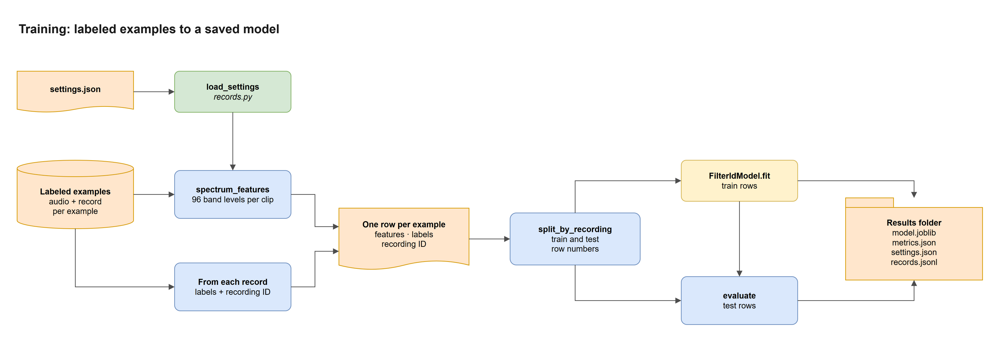
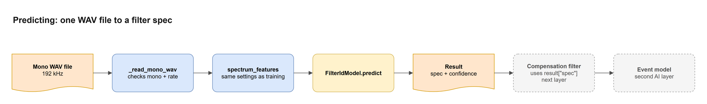

# Filter ID Code Map

I made these five diagrams to show how our part of the project, the filter ID model (the first AI layer), fits together, so anyone on the team can see how it works without reading all the code first. The source is `filter-id-code-map.drawio`, with one tab per diagram, and you can open and edit it at app.diagrams.net or in VS Code with the Draw.io Integration extension. I left `dataset.py` out on purpose. It's a temporary stand-in that makes synthetic training data in memory until the real test data generator is ready, so I drew the training input the way it'll work once the generator's files exist.

The colors mean the same thing in every diagram, and they match the project map in `docs/project-map/`. Blue is code that's built, yellow is the `FilterIdModel` class, green is the shared pipeline code, orange is a file or data, and a dashed box is a part that isn't built yet. A solid arrow means one part calls another or hands it something during the flow the diagram shows. A dashed arrow means something done ahead of time, like training, or a link that isn't a call, like an import or a shared format. The light gray boxes with a title in the corner just group things.

## 1. Code structure


The first layer lives in `pipeline/filter_id/`. The command line, `__main__.py`, is how you run it, with its `train` and `predict` commands, and other Python code can also import the main pieces straight from `pipeline.filter_id`. To turn audio into numbers, the command line calls `spectrum_features` in `features.py`, which gives back 96 band levels per clip. To train and score, it calls `split_by_recording`, `evaluate`, `save_model`, and `load_model` in `model.py`, and it calls `fit` and `predict` on the `FilterIdModel` class, which `model.py` defines (that's the diamond). `evaluate` calls `predict` too, once normally and once with each example's true type given. The long arrow down the left side is the command line calling `load_settings` in `records.py` to read the settings file.

The bottom row is the shared pipeline code that the rest of the project uses too. `records.py` imports the list of noise stages (`STAGES`) from `degrade.py`, which is the dashed arrow between them, so a record can only say the noise went in before or after the filter. The dashed arrow from `FilterIdModel` to `filters.py` isn't a call either. It means each result that `predict` returns has a spec in exactly the format `design_filter` takes. `predict` returns a list with one result per clip, and the spec is `result["spec"]`, so that's what the compensation filter should pass to `design_filter`.

## 2. How the parts connect


This is our part in context. The test data generator, which is being built, will make a WAV file and a record for every example, and the filter ID model trains on those ahead of time, so that arrow is dashed. Everything inside the offline app box runs when someone analyzes a recording. The recording goes into the filter ID model, which predicts the filter's type, order, and cutoffs. The compensation filter uses that prediction plus the recording itself to undo the filter, and the event model then looks for events in the compensated audio. What comes out is the predicted filter, the detected events, the compensated WAV file, and one file per recovered band.

The arrows going down show which shared code each part calls. The test data generator will use all three shared files, since it applies filters, adds noise and rounding, and writes a record for each example. The filter ID model uses `records.py` to read its settings, and the compensation filter will use `filters.py` to rebuild the predicted filter.

## 3. Training



A training run starts by reading `settings.json` with `load_settings`, which hands the feature settings to `spectrum_features`. Each labeled example gives two things. Its audio goes to `spectrum_features` and becomes 96 band levels, and its record gives the labels (the type, order, and cutoff of the filter that was really applied) and the recording it came from. The labels always come from the saved record, never from what someone meant to apply. Right now the examples are made in memory by the temporary `dataset.py`, and later they'll come from the test data generator's files.

That gives one row per example with its features, labels, and recording ID. `split_by_recording` only looks at the recording IDs. It puts each whole recording on either the training side or the test side, never both, and gives back the row numbers for each side, so the scores show how the model does on audio it has never heard. The training rows go to `FilterIdModel.fit`, and the trained model and the test rows go to `evaluate`. The results folder gets the saved model (`model.joblib`), the scores (`metrics.json`), a copy of the settings, and every example's record.

On the current synthetic data, the baseline gets the type right 95% of the time and the type and order both right 86% of the time on 40 held-out sources. The median cutoff error is 0.25 to 0.42 octaves depending on the edge, but that's measured with the true type given, so it scores the cutoff step on its own, not the whole model end to end.

## 4. Predicting



Predicting works on one mono WAV file at a time. `_read_mono_wav` reads the file and stops with a clear message if it isn't mono or isn't at the sample rate the model was trained on (192 kHz). `spectrum_features` turns it into band levels using the same settings that were saved with the model, since the model only understands features made the same way it was trained. `FilterIdModel.predict` then returns a result with a spec (the type, family, order, and cutoff) and how confident it is in the type and the order. The last two boxes are dashed because they aren't built yet. The compensation filter will take `result["spec"]` and rebuild the filter with `design_filter`, then pass the compensated audio to the event model.

## 5. Inside FilterIdModel


Inside the model, the 96 band levels first go through `_with_slopes`, which adds the slope between each pair of neighboring bands, for 191 numbers in total. A filter's knee is a change in slope, and the tree models can't easily subtract one number from another on their own, so handing them the slopes directly took the type and order accuracy from 0.74 to 0.86. The type classifier picks high-pass, low-pass, or band-pass first. The picked type decides which order classifier and which cutoff regressors run, since each type has its own, and those get the same 191 numbers. The cutoff regressors work in octaves, so a 10% miss counts the same at 100 Hz as at 10 kHz. Their answers are kept inside the range of cutoffs seen in training, so with our current settings they always come out as cutoffs the filter code accepts. The order and the cutoffs together make the spec.

## Updating the diagrams

To change a diagram, edit `filter-id-code-map.drawio` in app.diagrams.net or VS Code, then export each tab again as a PNG with the same name. In the draw.io desktop app, that's File, Export as, PNG, with a zoom of 200% and a border of 24. From a terminal with draw.io installed, this exports the first tab, and changing the page index (it starts at 1) and the file name does the others:

```
draw.io --export --format png --page-index 1 --scale 2 --border 24 --output docs/code-map/1-code-structure.png docs/code-map/filter-id-code-map.drawio
```
