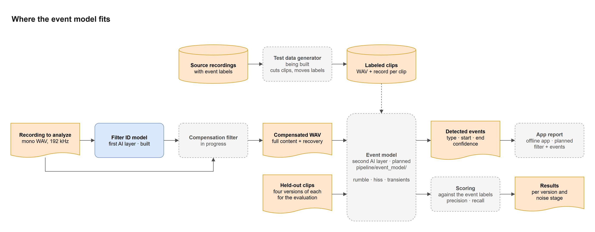
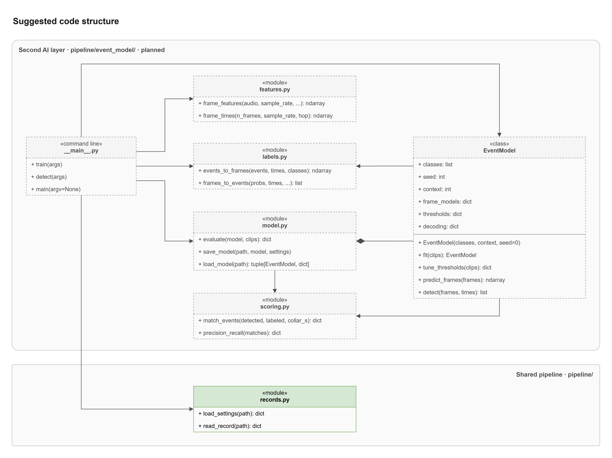
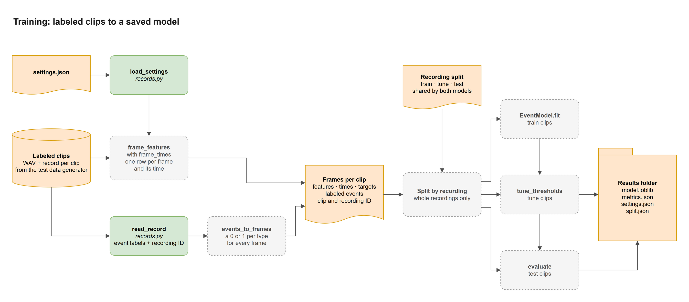
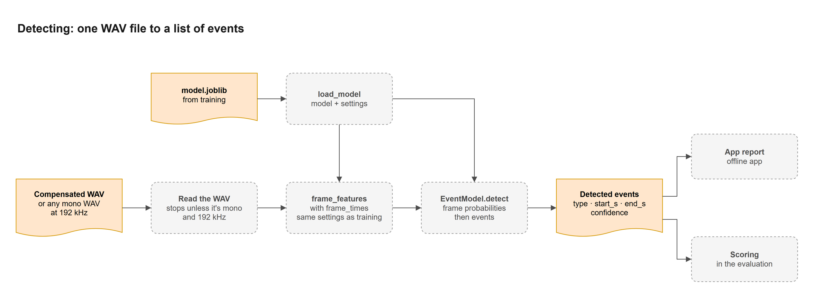
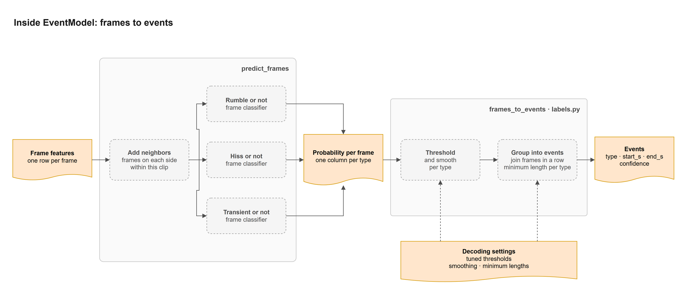
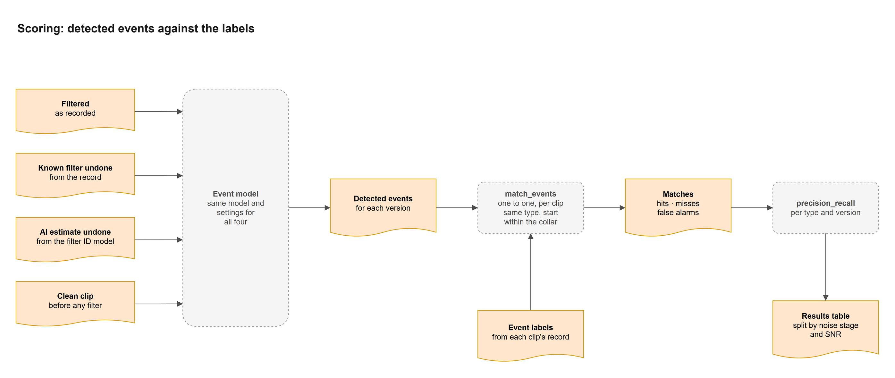

# Event Model Map

None of the event model is built yet, so this is a suggested starting point, including the file and function names.

Blue is built code, green is the shared pipeline, orange is a file or data, and a dashed box isn't built yet. A solid arrow is a call or hand-off, and a dashed arrow is something done ahead of time, like training.

## 1. Where it fits

The dashed arrow is training, done ahead of time. The compensation filter needs both the predicted filter and the recording itself. The input is the full compensated audio, not the band files, since the filtered and clean versions in the evaluation don't have band files.

## 2. Suggested code structure

The diamond means `model.py` defines `EventModel`. `fit`, `tune_thresholds`, and `evaluate` take a list of clips, where each clip keeps its own frames, frame times, targets, and labeled events, so nothing ever runs from one clip into the next. `predict_frames` and `detect` work on one clip at a time. Like the filter ID model, `save_model` saves the settings with the model. If the evaluation uses the same `scoring.py`, every run gets scored the same way.

## 3. Training

The record doesn't have a field for events yet, so the test data generator has to add one. Thresholds are tuned on recordings the model didn't train on, using the same event score we report, and the test clips are never used for training or tuning. The split file would be shared with the filter ID model, which makes its own two-way split right now, so its training code would need to read the file too.

## 4. Detecting

It works on any mono 192 kHz WAV, which is how the evaluation runs it on the filtered and clean versions too. The features have to use the settings saved with the model.

## 5. Inside EventModel

The neighboring frames let the model tell a steady hiss from a quick transient. That step has to work the same way in `fit`, and it stays inside one clip. There's one yes-or-no classifier per type because events can overlap, like a rumble under a hiss. The smoothing and minimum lengths are set per type so they don't wipe out short transients. A scikit-learn model is the simplest place to start, and a small PyTorch network could replace it later.

## 6. Scoring

The model and its settings stay the same across all four versions, so only the audio changes. Matching is one to one, per clip and version, so two detections near one labeled event count as one hit and one false alarm.
