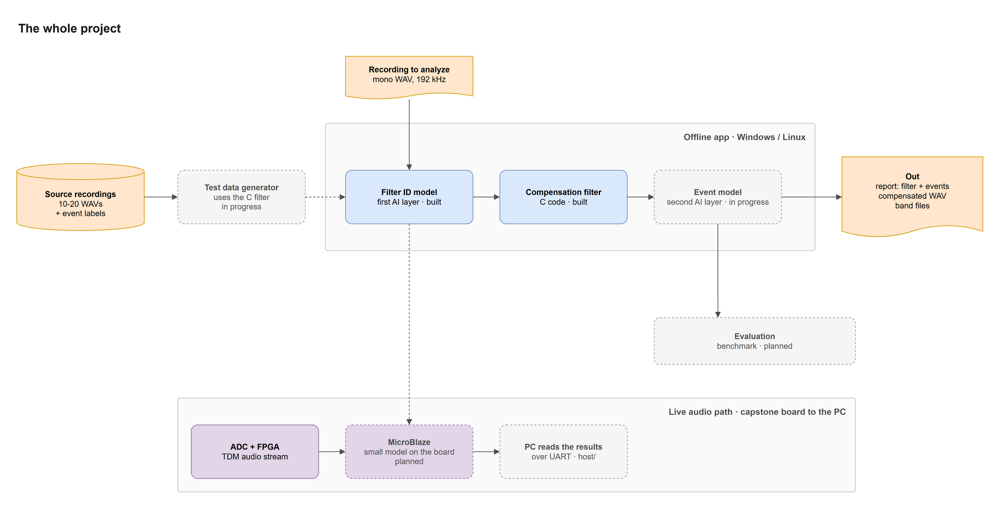
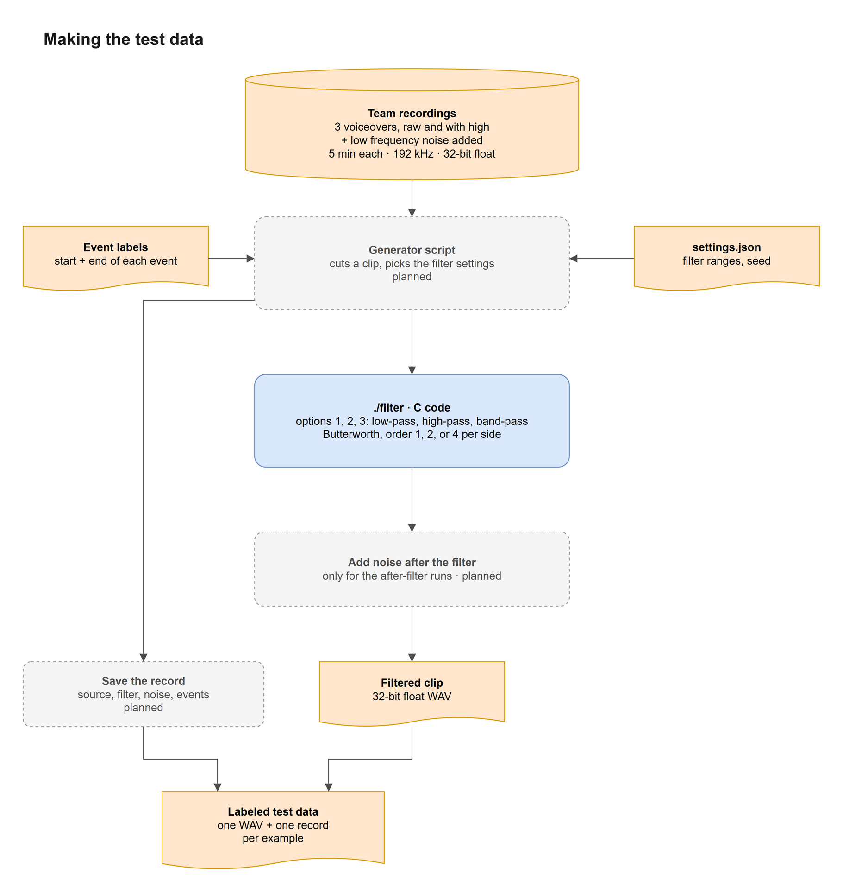
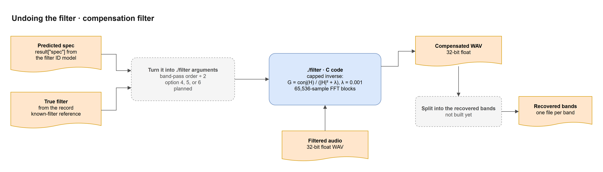
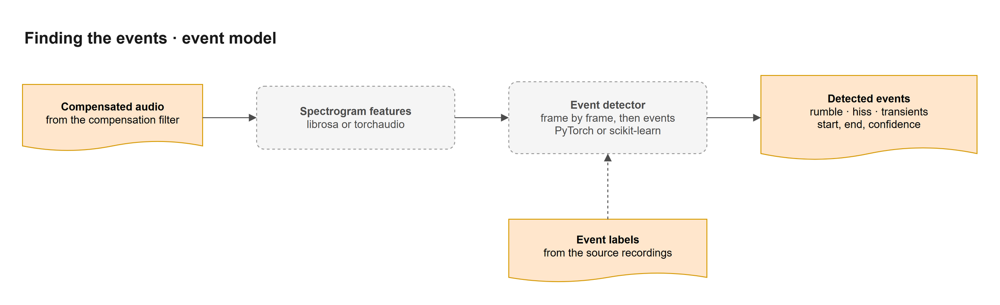
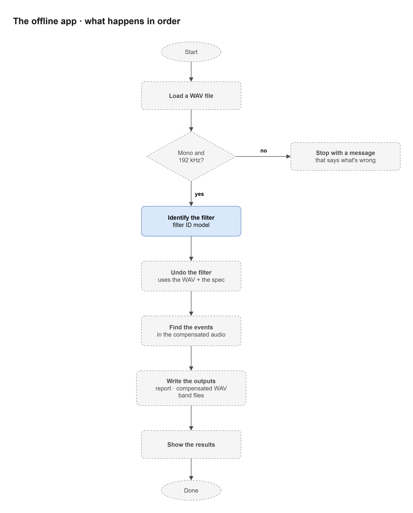
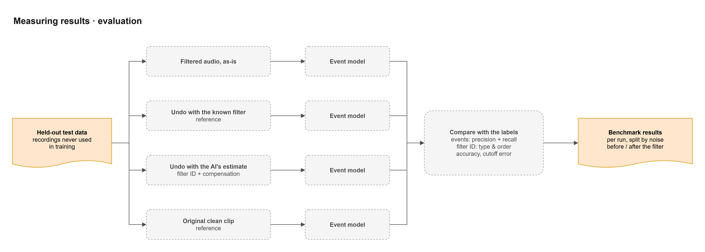
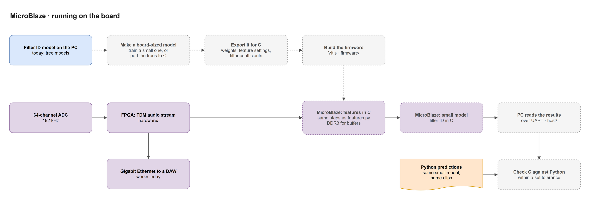

# Project Map

Blue is built code, orange is a file or data, purple is hardware, and a dashed box isn't built yet. A solid arrow is a hand-off or call, and a dashed arrow is something done ahead of time, like training or exporting a model, or a link that isn't a call. The filter ID model has its own map in `docs/code-map/`, and the event model has one in `docs/event-model-map/`.

## 1. The whole project

The dashed arrow from the test data generator is training, done ahead of time. The dashed arrow down to the MicroBlaze is a board-sized version of the filter ID model, made and exported on the PC (tab 7). The board runs C, so it gets its own version of the feature steps.

## 2. Making the test data

The C code in `pipeline/reversable_filters/` does the filtering, so the generator script only picks the settings, runs `./filter` on each clip, and writes the record. The noise in the team's recordings was added outside the repo, so those files are the noise-before-the-filter case. The after-filter runs still need noise added after `./filter`, since that comparison is in the proposal. `./filter` counts the order on each side, so the record's band-pass order is twice what gets passed in. The event label times shift to match where the clip starts, and every part gets its labels from the record, so it has to match what really happened to the audio.

## 3. Undoing the filter

The predicted spec is the real system. The true filter is a reference, and comparing the two shows how much the filter ID model's mistakes cost. Both go through the same `./filter` command, so the app has to turn a spec into its arguments, with the band-pass order halved since the C code counts each side. The λ in the inverse caps the boost, because a straight inverse would boost the noise too, and anything pushed below the noise floor can't come back. The C code doesn't split out the recovered bands yet.

## 4. Finding the events

The dashed arrow is the event model learning from the event labels ahead of time.

## 5. The offline app

The app has to hold on to things between steps. Undoing the filter needs the original WAV and the spec, and the outputs need the predicted filter, the events, and the compensated audio.

## 6. Measuring results

The known filter and the clean clip are references to compare against, and the test data only uses recordings that no model trained on. If undoing the filter doesn't improve detection, that's still a valid result, and we report it.

## 7. MicroBlaze

The DAW path over Ethernet works today, so it's drawn solid. The board-sized model is either a small model trained to give the same answers or the trees ported to C. The C features have to follow every step in `features.py` (the averaging, bands, dB, median, and slopes), not just the band layout. The board does its math with 32-bit floats or 8-bit integers instead of Python's 64-bit floats, so the last check shows whether those small differences change any predictions.
