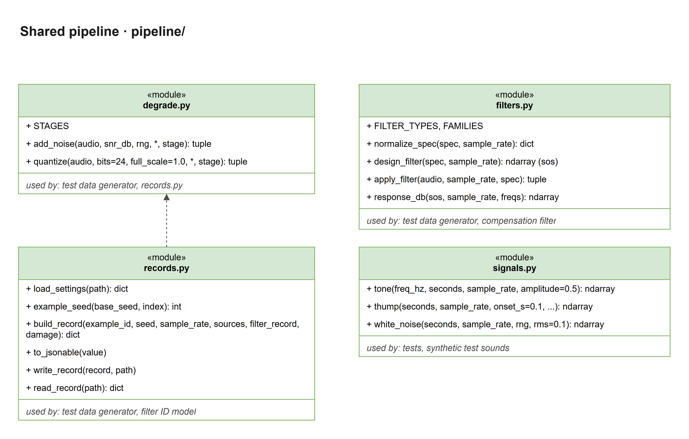
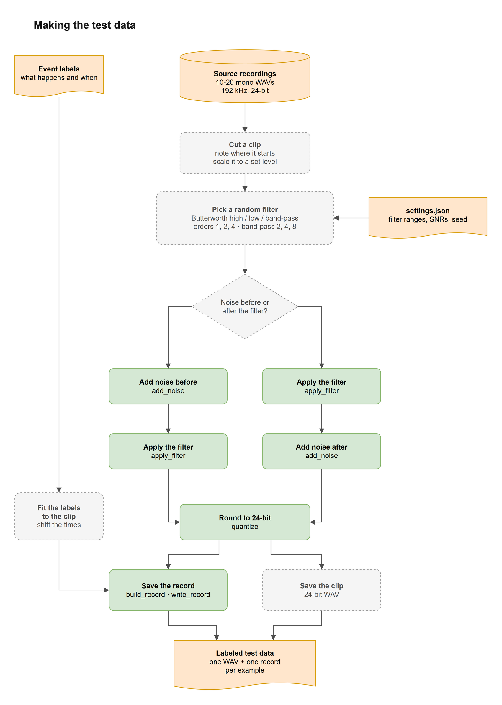
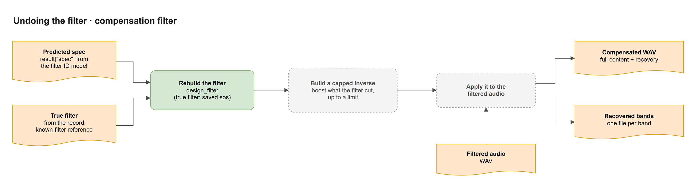
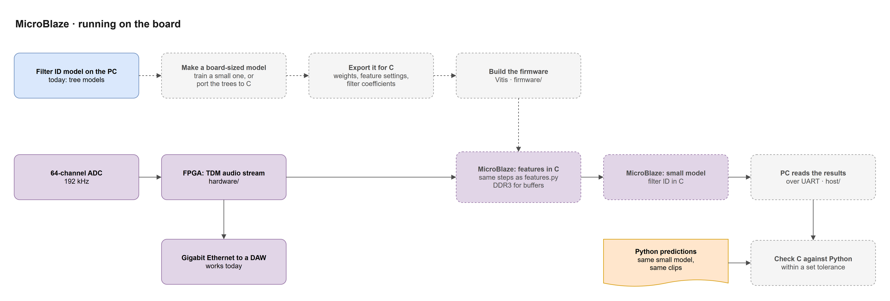

# Project Map

I made these eight diagrams so everyone can see how the whole project fits together: where your part sits, what it takes in, and what it hands to the next part. The source is `project-map.drawio`, with one tab per diagram, and you can open and edit it at app.diagrams.net or in VS Code with the Draw.io Integration extension. Most of the project isn't built yet, so most boxes show the plan from the approved proposal and our role sheet. The planned boxes, and the files passed between them, are my best guess at a starting point, so change them as we decide things. The MicroBlaze part was a stretch goal in the proposal, and I drew it assuming we're doing it. Our part, the filter ID model, has its own more detailed map in `docs/code-map/`. The questions I couldn't answer on my own are at the bottom.

The colors mean the same thing in every diagram, and they match the code map. Blue is code that's built, green is the shared pipeline code, orange is a file or data passed between parts, purple is the hardware and firmware, and a dashed box is a part that isn't built yet. A solid arrow means one part hands something to the next, or calls it, during the flow the diagram shows. A dashed arrow means something done ahead of time, like training or exporting a model, or a link that isn't a call, like an import. The light gray boxes with a title in the corner just group things.

## 1. The whole project


The project starts with 10 to 20 source recordings and the event labels that say what happens in them and when. The test data generator turns those into labeled test data, and the filter ID model trains on it ahead of time (the dashed arrow). Everything inside the offline app box runs when someone analyzes a recording. The recording goes into the filter ID model, which predicts the filter. The compensation filter uses that prediction and the recording to undo the filter, and the event model looks for events in the result. What comes out is a report with the predicted filter and the detected events, plus the compensated audio and one file per recovered band.

The evaluation takes the event model's results on held-out test data and measures whether undoing the filter really helps. The lane below it is the live path. The capstone board's ADC and FPGA stream the audio to the MicroBlaze, which runs a board-sized version of the filter ID model, and the PC reads its results over UART. The dashed arrow from the filter ID model is that version being made and exported ahead of time on the PC. The shared Python code along the bottom is what the Python parts build on. The board runs C, so it gets its own version of the steps it needs.

## 2. Shared pipeline



The shared pipeline is four small files in `pipeline/` that the Python parts use, so we all design filters, add noise, and save records the same way. `filters.py` checks a filter spec, designs the filter, applies it, and measures its response. `degrade.py` adds noise at an exact signal-to-noise ratio and rounds audio to a bit depth like a recorder would, and its `stage` (`before_filter` or `after_filter`) has to be passed by name. `records.py` reads settings files, gives each example its own seed, and builds and saves the record that says exactly what was done to an example. `signals.py` makes simple test sounds (a tone, a thump, and noise) for checking code before the real recordings are in.

The line at the bottom of each box says which parts use it. The one dashed arrow is an import: `records.py` takes the list of noise stages from `degrade.py`, so a record can only say "before the filter" or "after the filter."

## 3. Making the test data



The test data generator makes one example at a time. It cuts a clip from a source recording, notes where the clip starts, and scales it to a set level. Then it picks a random Butterworth filter from the ranges in `settings.json`. High-pass and low-pass filters use orders 1, 2, and 4. A band-pass uses total orders 2, 4, and 8, because our code counts every pole and a band-pass has two edges, so there's no first-order band-pass. How we count band-pass order is still up to the team. Next it decides whether the noise goes in before or after the filter. That's one of the comparisons in the proposal, since noise added before the filter gets filtered too, while noise added after it covers even the parts the filter cut. Either way, the clip then gets rounded to 24-bit like a real recording.

The event labels have to follow the clip, so their times get shifted to match where the clip starts. Then the generator saves two things. The record has everything that was done: the source recording, where the clip starts, the exact filter, the noise, the rounding, and the events. The clip itself gets saved as a 24-bit WAV. The record is where every part gets its labels, so it has to match what really happened to the audio. The green steps already exist in the shared pipeline, and fitting the labels and saving the WAV are new.

## 4. Undoing the filter



The compensation filter can start from either of two specs. The predicted spec from the filter ID model (`result["spec"]`) is the real system. The true filter from the example's record is a known-filter reference, and comparing the two shows how much the filter ID model's mistakes cost. For the true filter, it's easiest to use the coefficients already saved in the record (`sos`), since the record's filter entry has a few extra fields that `design_filter` won't take. Either way, the next step builds an inverse that boosts what the filter cut. The boost needs a cap, because a straight inverse would boost the noise along with everything else, and anything pushed below the noise floor can't come back.

The inverse gets applied to the filtered audio, so this step needs the original WAV as well as the spec. Following the role sheet, the output is the compensated audio with the full content plus the recovery, and a separate file for each recovered band.

## 5. Finding the events


The event model, which is the second AI layer, works on the compensated audio. It turns the audio into spectrogram features with librosa or torchaudio, and an event detector built with PyTorch or scikit-learn goes through them frame by frame and then groups the frames into events. The proposal names three kinds of events: low-frequency rumble, broadband hiss, and short transients. Each detected event comes out with its type, its start and end time, and how confident the model is. The dashed arrow is the event labels from the source recordings, which the detector learns from ahead of time.

## 6. The offline app


The offline app is the main deliverable: a Windows or Linux program that analyzes one recording at a time. It loads a WAV file and checks that it's mono and at 192 kHz, and if it isn't, it stops with a message that says what's wrong. Otherwise it runs our three parts in order: identify the filter, undo it, and find the events. The app has to hang on to things along the way, since undoing the filter needs the original WAV and the spec, and the outputs need the predicted filter, the events, and the compensated audio. Then it writes the report, the compensated WAV, and the band files, and shows the results.

## 7. Measuring results


The evaluation answers the main question in the proposal: does undoing the filter help find the events? It only uses held-out recordings that no model trained on. The same examples go through four versions: the filtered audio as-is, undone with the known filter from the record, undone with the AI's estimate, and the original clean clip. The known filter and the clean clip are references to compare against. The event model runs on each version, and its detections are compared with the event labels to get precision and recall, kept separate for each run. The filter ID model gets scored here too, with its type and order accuracy and its cutoff error.

The results get split by whether the noise went in before or after the filter. If undoing the filter doesn't improve detection, that's still a valid result, and we report it.

## 8. MicroBlaze



This tab shows the on-board path in detail. The capstone board's 64-channel ADC feeds the FPGA, which turns the audio into a TDM stream. That stream already goes over gigabit Ethernet to a DAW, which works today, so it's drawn solid. The new part is the MicroBlaze. Our filter ID model is made of scikit-learn tree models right now, so first we need a board-sized version, either a small model trained to give the same answers or the trees ported to C. That gets exported for C (the weights, the feature settings, and any filter coefficients) and built into the firmware with Vitis. On the board, the MicroBlaze works out the features from the TDM stream in C, using the DDR3 memory for audio buffers. It has to follow the same steps as `features.py` (the averaging, the bands, dB, the median, and the slopes), not just use the same band layout. Then it runs the small model, and the results go to the PC over UART, where a reader in `host/` picks them up.

The last step is checking that the C version gives the same answers as Python for the same small model on the same clips, within a tolerance we set. The board does its math with 32-bit floats or 8-bit integers instead of Python's 64-bit floats, so small differences are expected, and this check shows whether they change any predictions. The `hardware/`, `firmware/`, and `host/` folders in the repo are where this work goes.

## Open questions for the team

These came up while I was drawing the plan, and I don't think one person should decide them, so let's go over them at the next meeting.

**How do we count band-pass order?** Our code counts total poles, so a band-pass is order 2, 4, or 8. A DAW counts each side, so the same filters would be 1, 2, or 4. Either works, but the labels, the code, and the report all need to use the same one.

**How should the event labels follow a clip?** When a clip gets cut out of a recording, the event times have to shift, and we need a rule for events that get cut in half at the clip's edges. The record should also say exactly where the clip came from, so the evaluation can find the clean version of the same clip.

**Should every model use the same train and test split?** The filter ID model, the event model, the board-sized model, and anything we tune should all keep the same recordings out of training. One saved list of which recordings are for training, tuning, and testing would make sure of that.

**How do we run the noise comparison fairly?** For a clean before-and-after comparison, both versions should use the same clip, filter, and SNR. The SNR is measured against whatever audio the noise gets added to, so the same SNR before and after the filter doesn't mean the same amount of noise. We also need to decide whether the noise we add counts as "hiss" or as background, so the event labels don't contradict themselves.

**How do we score the events?** We need a rule for when a detected event matches a labeled one, like how far off the start time can be. The event model and its thresholds should also stay the same across all four evaluation runs.

**What exactly does the compensation filter save?** "Full content + recovery" could mean the whole compensated signal or just what got added back, and adding them together would count the recovery twice. We also need the band edges for the band files, the output format, and a plan for clipping, since a capped boost can still push audio past full scale.

**How does the board pick its audio?** The board has 64 channels, so we need to pick which one the MicroBlaze listens to, how long a window it looks at, and how often it sends results.

**Do we process in 32-bit like the proposal says?** Our Python code uses 64-bit floats, which is more precise. I'd keep 64-bit as the reference on the PC and use 32-bit on the board, but we should write that down as a decision.

## Updating the diagrams

To change a diagram, edit `project-map.drawio` in app.diagrams.net or VS Code, then export each tab again as a PNG with the same name. In the draw.io desktop app, that's File, Export as, PNG, with a zoom of 200% and a border of 24. From a terminal with draw.io installed, this exports the first tab, and changing the page index (it starts at 1) and the file name does the others:

```
draw.io --export --format png --page-index 1 --scale 2 --border 24 --output docs/project-map/1-whole-project.png docs/project-map/project-map.drawio
```
