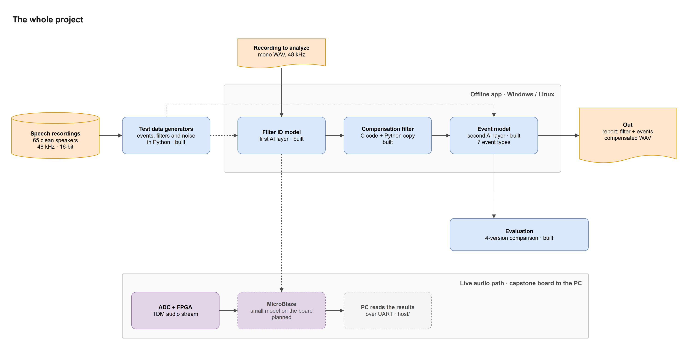
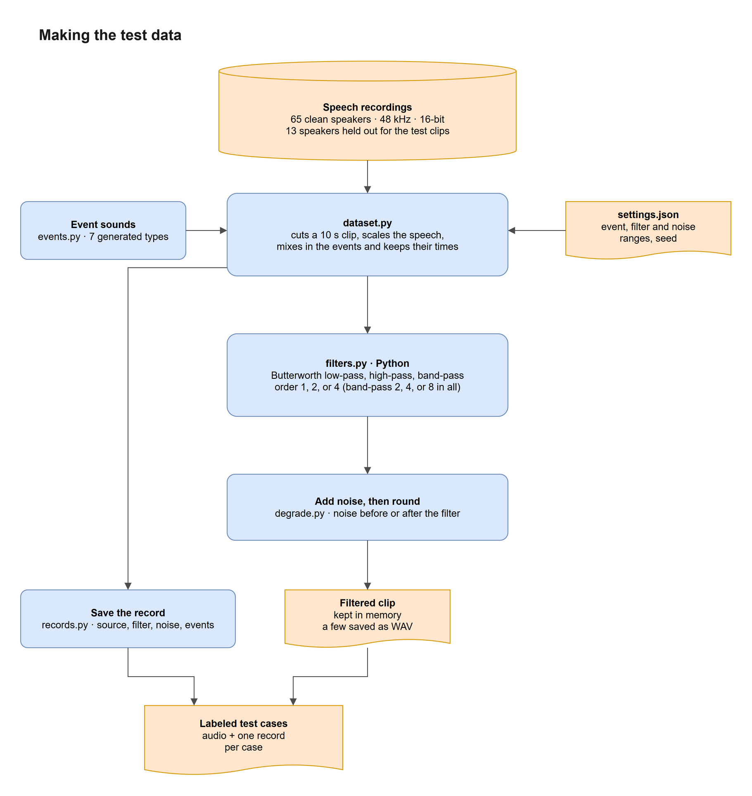
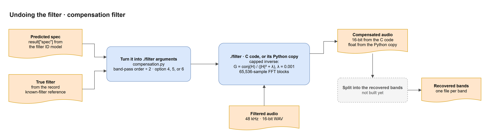
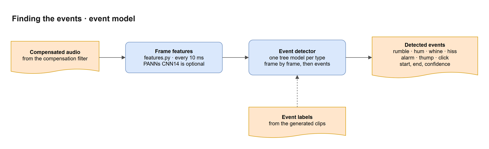
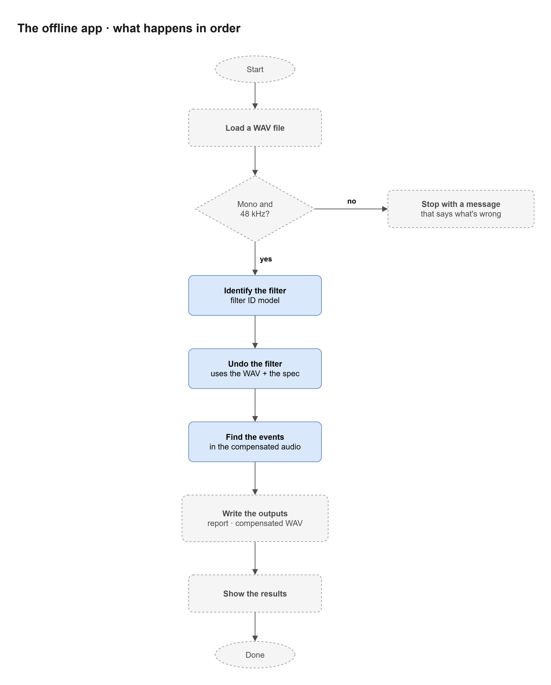
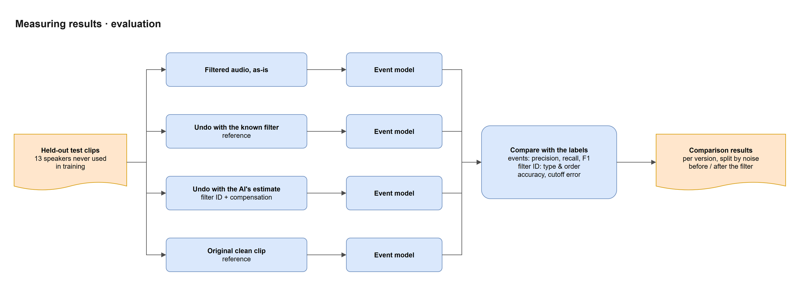
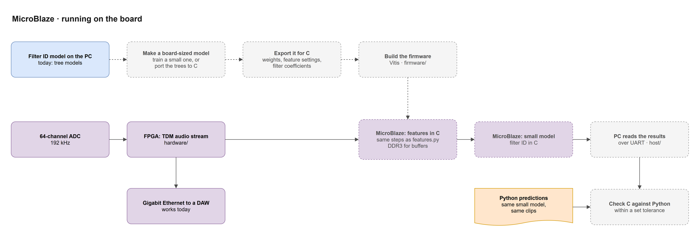

# Project Map

Blue is built code, orange is a file or data, purple is hardware, and a dashed box isn't built yet. A solid arrow is a hand-off or call, and a dashed arrow is something done ahead of time, like training or exporting a model, or a link that isn't a call. The filter ID model has its own map in `docs/code-map/`, and the event model has one in `docs/event-model-map/`.

## 1. The whole project

The dashed arrows from the test data generators are training, done ahead of time. Each model has its own generator, and both filter and add noise in Python. The parts inside the offline app are built, but the app that runs them in order is still a spec in `pipeline/app.py` (tab 5). The dashed arrow down to the MicroBlaze is a board-sized version of the filter ID model, made and exported on the PC (tab 7). The board runs C, so it gets its own version of the feature steps.

## 2. Making the test data

This is the event model's test data. The filter ID model makes its own examples the same way from 1 s pieces of the same speech, with no events. Every event is generated, none is recorded, so the labels are exact. Each filter gets two cases with the same noise, one with it added before the filter and one after. `filters.py` counts a band-pass order as the total for both sides, so it's twice what the C code's `./filter` takes. The C code's own filter options (1, 2, 3) aren't used here. Every part gets its labels from the record, so it has to match what really happened to the audio.

## 3. Undoing the filter

The predicted spec is the real system. The true filter is a reference, and comparing the two shows how much the filter ID model's mistakes cost. The Python copy does the same math as the C code, and it's what runs when `./filter` isn't built. The C code reads and writes 16-bit WAVs, so anything the undo pushes past full scale gets clipped, while the Python copy keeps it. The λ in the inverse caps the boost, because a straight inverse would boost the noise too, and anything pushed below the noise floor can't come back. Nothing splits out the recovered bands yet.

## 4. Finding the events

The dashed arrow is the event model learning from the event labels ahead of time. It trains on clean clips, and the settings can add filtered and undone clips. PANNs CNN14 is a pretrained sound model that can add its 527 sound probabilities to our features. It's off by default.

## 5. The offline app

The three blue steps call code that's built. The dashed steps are the app itself, which is still a spec in `pipeline/app.py` with its tests in `pipeline/tests/test_app.py`. The app has to hold on to things between steps. Undoing the filter needs the original WAV and the spec, and the outputs need the predicted filter, the events, and the compensated audio.

## 6. Measuring results

The known filter and the clean clip are references to compare against, and the test clips only use speakers that no model trained on. Every version of a clip goes through the same event model with the same thresholds. If undoing the filter doesn't improve detection, that's still a valid result, and we report it.

## 7. MicroBlaze

The DAW path over Ethernet works today, so it's drawn solid. The board-sized model is either a small model trained to give the same answers or the trees ported to C. The C features have to follow every step in `features.py` (the averaging, bands, dB, median, and slopes), not just the band layout. The board does its math with 32-bit floats or 8-bit integers instead of Python's 64-bit floats, so the last check shows whether those small differences change any predictions.
